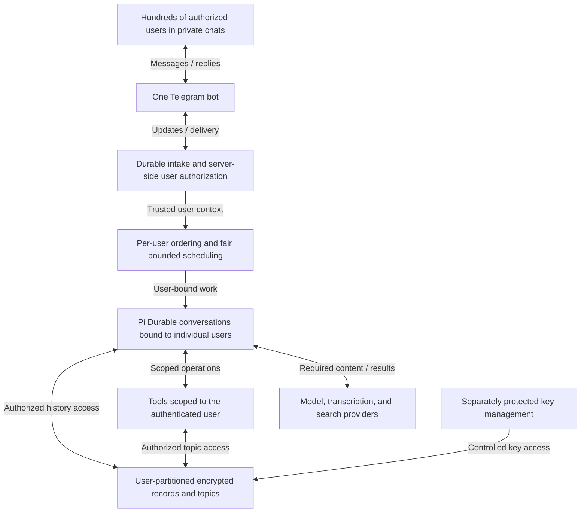

# Roadmap

This document separates the released architecture from the next product target.
The [v0 PRD](PRD.md) defines the single-user product;
[Validation](VALIDATION.md) records what has actually been demonstrated.
Nothing in the v1 design below is implemented or a current privacy guarantee.

## v0.1.0: one user per bot instance

The first release preserves the architecture proven locally and on the VPS:
one authorized Telegram user, one persistent Pi Durable conversation, explicit
saved topics, voice input, web research, and local reply feedback. The guided
installer and stopped-service migration have been exercised on the VPS.

This is a useful single-user release, not a multi-user deployment. Do not add a
second user to the existing instance by bypassing its owner check. Its history,
topics, status, and feedback are not designed for multiple owners. Stored content
is not encrypted by the application, and a server administrator can read it.

## v1 target: one bot for hundreds of users

One Telegram bot and one deployed Finrod service should serve hundreds of
authorized people in separate private chats. Users must not need another bot,
service account, or VPS. Each user gets independent conversation history, saved
knowledge, transcripts, and feedback. Shared household or organizational memory
is not implicit in membership and is outside this initial multi-user scope.

“Hundreds” is a capacity target, not a benchmark result or a promise of hundreds
of simultaneous model calls. Define the admitted-user count, active concurrency,
message sizes, latency budget, and cost limits before the capacity acceptance run.
Measure a single-host design before introducing distributed infrastructure.

### Proposed logical architecture

This is a logical target, not a prescribed set of new services. Reuse Pi's
conversation, extension, task, and recovery mechanisms. Verify the pinned
runtime's APIs and storage constraints before choosing implementation boundaries.
Finrod should enforce user identity and access around those mechanisms, not
build another agent engine or memory framework.

## Isolation requirements

- Admit users through an explicit allowlist or invitation policy. Do not turn
  possession of the public bot address into permission to consume resources.
- Derive internal user identity from verified Telegram updates and an application
  mapping. Never accept a model-supplied user ID as authorization.
- Bind every conversation, queued task, transcript, reply, topic, feedback record,
  export, and recovery operation to its owning user.
- Enforce access in application and storage operations, including tool calls.
  Prompt instructions alone are not an isolation boundary.
- Keep model context, compaction summaries, caches, and restored tasks scoped.
  A restart or retry must not restore work under another user's identity.
- Route outgoing replies and feedback callbacks through the same ownership checks.
  Commands such as status, topic listing, export, and deletion must be user-scoped.
- Preserve each user's turn ordering without making a slow request block everyone.
  Bound global and per-user concurrency, queued work, retries, and spending.
- Keep operator diagnostics useful without recording private content by default.
  Authentication failures must not disclose another user's records or membership.

## Privacy and encryption

### State the threat model first

| Threat | Required protection or explicit boundary |
| --- | --- |
| Another ordinary user requests someone else's data | Deny access at every storage, tool, context, and delivery boundary |
| A database, topic directory, or backup is copied without keys | Encrypt private content and keep key material outside the copied data set |
| A stored record is modified or moved between users | Use authenticated encryption and bind records to their owner and identity |
| A Telegram account or application credential is compromised | Define revocation, recovery, and any additional authentication requirements |
| The live host or privileged operator is compromised | Server-managed encryption alone does not prevent access to plaintext during processing |
| Telegram or an inference provider receives a request | Explain what that provider sees and its retention policy; local encryption does not cover it |

Telegram delivers bot messages to the service for processing. The bot and its
model/transcription providers need access to relevant plaintext. Do not describe
this server-side architecture as end-to-end encrypted or inaccessible to its
operator. ZDR routing governs provider retention; it is not a replacement for
local encryption, authorization, or provider access disclosure.

If confidentiality from the live server operator is required, resolve that
requirement before approving the v1 design. It can require a different client,
key-custody model, and processing boundary—not simply encrypted SQLite files.

### Candidate design: per-user envelope encryption

Use a maintained cryptographic library and authenticated encryption, not a
custom cipher. A candidate design gives each user a randomly generated data key.
That key encrypts private records and is itself wrapped by a separately protected
key-encryption key. Associate ciphertext with its user, record identity, and
format version so substituting another user's ciphertext does not bypass checks.

The design must cover all persistent copies: Durable entries and task payloads,
Telegram transcripts and replies, saved topics, caches, exports, and backups.
Encrypting only the main conversation table would leave other copies exposed.
Decide which routing metadata must remain readable and document the resulting
metadata leakage. Verify how encryption integrates with Pi Durable storage before
selecting a database layout or a key-management product.

Keys must not be stored in plaintext beside ciphertext or included in the same
unprotected backup. Define access, rotation, recovery, revocation, and key-loss
behavior. Prove restoration with the intended key-recovery procedure before
migrating the only copy of a user's history.

### Authentication is not an encryption key

The Telegram bot token authenticates the bot; it is not a separate secret for
each user. A Telegram user ID is an identifier, not key material. A rotating
application access token is also unsuitable as the direct key for durable
history: token rotation or expiry must not accidentally destroy access to data.

Authentication should authorize access to the appropriate user's key, not turn
the bearer credential itself into that key. A user-held secret could participate
in wrapping or unlocking a key, but that is an unresolved design option. It adds
recovery and usability decisions, and it does not by itself hide plaintext from
a server that decrypts messages during processing.

### User control and retention

Document what users can export or delete, what metadata remains, how long backups
retain deleted content, and what Telegram or external providers retain separately.
Do not promise immediate deletion from every copy unless the system can enforce
it. Administrative support access must have an explicit policy and an audit trail.
Logs and audit records must not become another unprotected conversation archive.

## Delivery stages and release gates

### 1. Approve the privacy and access contract

Decide admission policy, threat model, key custody and recovery, operator access,
retention/deletion semantics, and the initial capacity workload. Keep these
choices explicit rather than presenting candidate encryption as an implemented
guarantee.

**Gate:** a reviewed v1 PRD with testable privacy claims and acknowledged limits.

### 2. Prove isolation with two users on one bot

Assign the existing v0 conversation and topics to their original owner without
resetting history. Add a second authorized user with independent state. Use Pi's
existing mechanisms to enforce scoped context and execution.

**Gate:** end-to-end checks cover text, voice, topics, feedback, status, failures,
retries, and restart recovery. Neither user can read or modify the other's data,
including through crafted identifiers, tool arguments, or prompt injection.
Unauthorized users cannot start paid work.

### 3. Implement encrypted persistence and recovery

Apply the approved storage and key design to all identified copies. Migrate v0
state with a recoverable backup and an explicit point after which plaintext
copies are retired according to policy.

**Gate:** demonstrate encryption, tamper rejection, key separation, rotation,
revocation, export/deletion behavior, and recovery after a restore. Document
what remains visible to the application, operator, and external providers.

### 4. Validate capacity for hundreds of users

Exercise fair scheduling, bounded queues, model/provider rate limits, storage
contention, slow users, and restart recovery under the agreed workload. Use
controlled provider substitutes for load, plus limited live integration checks.
Measure response times, resource use, failure rates, and per-user cost controls.

**Gate:** the agreed workload meets its budgets without data mixing or starvation.
Do not infer capacity from a test with only two users or provision more servers
before measuring the current design.

### 5. Pilot and release v1

Start with a small invited group on the shared bot, inspect failures and feedback,
and expand only after the isolation, privacy, recovery, and capacity gates pass.
The existing v0.1.0 tag remains the single-user reference; it is not a drop-in
rollback once new multi-user or encrypted state has been written.

## References

- [Telegram Bot API](https://core.telegram.org/bots/api): bot authorization,
  update identity, and message routing.
- [OWASP Cryptographic Storage guidance](https://cheatsheetseries.owasp.org/cheatsheets/Cryptographic_Storage_Cheat_Sheet.html):
  threat modeling, authenticated encryption, and key management.
- [Current architecture](ARCHITECTURE.md): implemented behavior, not the v1 target.
